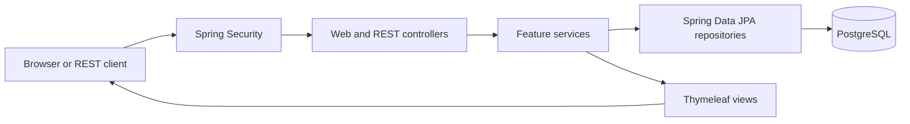

# AgroShop

**Pesticide Inventory & Credit Management System**

> A web-based system for pesticide inventory, sales, customer credit, and payment tracking at village shops.

## Overview

Village pesticide shops need to track products and stock while managing customer purchases that may be paid over time. Scattered records can make it difficult to spot low stock, follow customer balances, and reconcile payments with sales.

AgroShop brings these workflows together in a server-rendered web application. Its modular Spring Boot design separates products, inventory, customers, sales, payments, receipts, and dashboard logic. PostgreSQL stores the data, while transactional service operations support consistent stock and financial records.

The project is intended as a demo and learning application, not as production banking software. It uses environment-based credentials and provides a Docker image for containerized deployment.

## Key Features

- **Product management:** Create, view, update, and deactivate products without removing historical records.
- **Inventory tracking:** Record stock movements and flag active products at or below their low-stock threshold.
- **Sales and billing:** Create sales with line items and track invoice payment status.
- **Customer credit:** Review customer purchase history and outstanding balances.
- **Payment allocation:** Apply payments to invoices and present reconciled balances across customer and dashboard views.
- **Receipts:** Generate printable receipts for sales.
- **Dashboard:** View shop activity and financial summaries.
- **Protected access:** HTTP Basic authentication protects application routes; the health endpoint is public.

## Tech Stack

| Category | Technologies |
|---|---|
| Backend | Java 21, Spring Boot 3.5.7, Spring MVC, Spring Data JPA, Spring Security, Jakarta Bean Validation |
| Frontend | Thymeleaf, Bootstrap 5.3.3 WebJar, HTML, CSS |
| Database | PostgreSQL; H2 for tests |
| Build and tests | Gradle 9.6.0 wrapper, JUnit 5, Spring Boot Test, Spring Security Test |
| Containerization | Docker multi-stage build, Gradle 9.6.0 JDK 21 builder, Eclipse Temurin 21 JRE |
| AI/ML | None |

## Architecture Summary

AgroShop is a feature-based modular monolith. Browser requests and REST requests pass through Spring Security to controllers. Controllers delegate business operations to services; services use repositories backed by Spring Data JPA to read and update PostgreSQL. Thymeleaf renders the web pages on the server.



## Installation & Setup

### Prerequisites

- Java 21
- PostgreSQL 17 (or a compatible PostgreSQL version)
- Git
- Docker, if you want to run the container image

The Gradle wrapper is included, so a separate Gradle installation is not required.

### 1. Clone the repository

```bash
git clone <REPOSITORY_URL>
cd pesticide-inventory
```

Replace `<REPOSITORY_URL>` with the GitHub repository URL.

### 2. Create a dedicated local database

Connect to PostgreSQL as an administrator:

```bash
psql -d postgres
```

Then create a role and a development database:

```sql
CREATE ROLE agroshop_app LOGIN;
\password agroshop_app
CREATE DATABASE agroshop_demo OWNER agroshop_app;
\q
```

The `\password` command prompts for the role password. Use a dedicated demo database; do not point a demo instance at a database containing business data.

### 3. Configure environment variables

Create a local `.env` file and replace the placeholders:

```dotenv
DB_URL=jdbc:postgresql://127.0.0.1:5432/agroshop_demo
DB_USERNAME=agroshop_app
DB_PASSWORD=REPLACE_WITH_DATABASE_PASSWORD

SPRING_SECURITY_USER_NAME=shopowner
SPRING_SECURITY_USER_PASSWORD=REPLACE_WITH_A_STRONG_LOGIN_PASSWORD

PORT=8080
SHOP_NAME=AgroShop
SHOP_ADDRESS=
SHOP_PHONE=
```

Do not commit `.env` or real credentials. Spring Boot does not load `.env` files automatically. In macOS/Linux shells, load the variables before running the app:

```bash
set -a
. ./.env
set +a
```

In PowerShell, set the variables in the current terminal session:

```powershell
$env:DB_URL = "jdbc:postgresql://127.0.0.1:5432/agroshop_demo"
$env:DB_USERNAME = "agroshop_app"
$env:DB_PASSWORD = "REPLACE_WITH_DATABASE_PASSWORD"
$env:SPRING_SECURITY_USER_NAME = "shopowner"
$env:SPRING_SECURITY_USER_PASSWORD = "REPLACE_WITH_A_STRONG_LOGIN_PASSWORD"
$env:PORT = "8080"
```

### 4. Run the application

macOS/Linux:

```bash
./gradlew bootRun
```

Windows:

```powershell
.\gradlew.bat bootRun
```

The local configuration uses Hibernate `ddl-auto: update`. This is for development convenience and is not a replacement for versioned database migrations.

### 5. Open AgroShop

Visit <http://localhost:8080>. Authenticate with the username and password configured in the environment. The browser may show an HTTP Basic authentication prompt.

The public health endpoint is available at:

```text
http://localhost:8080/api/health
```

### Run with Docker

Build the image from the repository root:

```bash
docker build -t agroshop:demo .
```

For Docker Desktop on macOS, if PostgreSQL is available on the host at port `5433`, run the app with:

```bash
docker run -d --name agroshop-demo \
  -p 127.0.0.1:8080:8080 \
  --env-file .env \
  -e DB_URL='jdbc:postgresql://host.docker.internal:5433/agroshop_demo?sslmode=disable' \
  agroshop:demo
```

The Docker image uses the `prod` profile, which sets Hibernate `ddl-auto: validate`. The database schema must already exist; the image does not initialize or migrate the database. Do not use a production database for one-time schema initialization.

## Usage

Check application health:

```bash
curl http://localhost:8080/api/health
```

Expected response:

```json
{"status":"UP"}
```

List products through the authenticated REST API:

```bash
curl --user "$SPRING_SECURITY_USER_NAME:$SPRING_SECURITY_USER_PASSWORD" \
  http://localhost:8080/api/products
```

The response is a JSON product list. It may be empty if no products have been created.

Common web pages include:

- Dashboard: `/`
- Products: `/products`
- Inventory: `/inventory`
- Customers: `/customers`
- Sales: `/sales`
- Payments: `/payments`

## Project Structure

```text
.
├── build.gradle
├── Dockerfile
├── gradlew
├── gradlew.bat
├── src
│   ├── main
│   │   ├── java/com/agroshop
│   │   │   ├── common/       # Health endpoint and shared exception handling
│   │   │   ├── config/       # Shared configuration
│   │   │   ├── customer/     # Customer profiles and purchase history
│   │   │   ├── dashboard/    # Dashboard summaries
│   │   │   ├── demodata/     # Guarded demonstration-data support
│   │   │   ├── inventory/    # Stock movements and inventory operations
│   │   │   ├── payment/      # Payments and invoice allocations
│   │   │   ├── product/      # Product management
│   │   │   ├── receipt/      # Receipt generation
│   │   │   ├── sales/        # Sales and invoice operations
│   │   │   └── security/     # Authentication and route security
│   │   └── resources
│   │       ├── db/manual/    # Manual SQL resources
│   │       ├── static/       # Static assets
│   │       ├── templates/    # Thymeleaf pages and fragments
│   │       └── application*.yml
│   └── test
│       ├── java/             # Unit and integration tests
│       └── resources/        # Test configuration
└── docs/                     # QA documentation
```

## Configuration

| Name | Description | Type | Default |
|---|---|---|---|
| `DB_URL` | PostgreSQL JDBC URL | Environment variable | `jdbc:postgresql://localhost:5432/pesticide_inventory` |
| `DB_USERNAME` | PostgreSQL role | Environment variable | Required |
| `DB_PASSWORD` | PostgreSQL password | Environment variable | Required |
| `SPRING_SECURITY_USER_NAME` | Application login username | Environment variable | Required |
| `SPRING_SECURITY_USER_PASSWORD` | Application login password | Environment variable | Required |
| `PORT` | HTTP server port | Environment variable | `8080` |
| `SHOP_NAME` | Shop name displayed on receipts | Environment variable | `AgroShop` |
| `SHOP_ADDRESS` | Optional shop address | Environment variable | Empty |
| `SHOP_PHONE` | Optional shop phone number | Environment variable | Empty |
| `SPRING_PROFILES_ACTIVE` | Spring profile; Docker image uses production profile | Environment variable | Default profile locally; `prod` in Docker |
| `DEMO_DB_URL` | JDBC URL used by the demo profile | Environment variable | `jdbc:postgresql://127.0.0.1:5432/agroshop_demo` |
| `spring.jpa.hibernate.ddl-auto` | Hibernate schema behavior | Spring property | `update` locally; `validate` in `prod` |

## Roadmap

These are potential future improvements, not committed releases:

- Add a versioned database migration strategy.
- Add a dedicated PostgreSQL integration-test workflow in CI.
- Expand authentication and authorization beyond the current shop-owner login.
- Add operational monitoring and configurable health/readiness checks.
- Improve deployment documentation for additional hosting providers.

## Contributing

Contributions and suggestions are welcome.

1. Open an issue to discuss substantial changes before starting implementation.
2. Create a focused branch, such as `feat/payment-history` or `fix/stock-validation`.
3. Keep changes scoped and follow the existing package and test conventions.
4. Run the relevant tests before opening a pull request:

   ```bash
   ./gradlew clean test
   ```

5. Open a pull request describing the change, validation performed, and any configuration or database considerations.

Never include credentials, private keys, or production data in commits or pull requests.

## License

**Suggested license: MIT.** No license file was found in the repository. Confirm the license and copyright holder, then add a `LICENSE` file containing the chosen license before describing the project as licensed. Until then, no open-source license is granted.

## Acknowledgments

AgroShop was developed collaboratively by human contributors, including Swapnil Jejurkar, with AI-assisted engineering and documentation support. The project builds on open-source technologies including Spring Boot, Spring Security, Thymeleaf, Bootstrap, PostgreSQL, Gradle, and Eclipse Temurin. Refer to each dependency’s own license and notices for attribution requirements.
